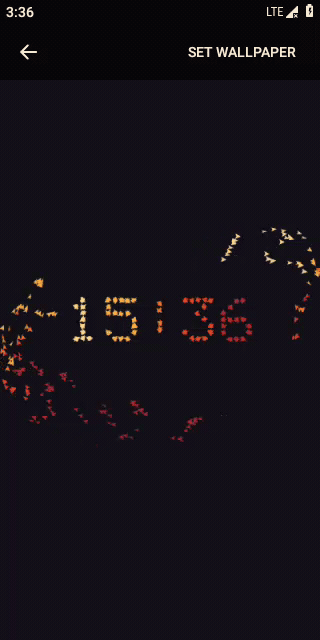

# CbirdsWatch

Android 9（API 28）动态壁纸。应用使用 Kotlin，设置页使用 Jetpack Compose。鸟群排成 HH:mm:ss，其余的鸟分成三群，跟随各自的领头鸟穿行。壁纸按实际画布的短边居中绘制正方形，鸟形随短边等比缩放。WallpaperService 仅在壁纸可见时安排绘制。

在 Android Studio 中打开项目并选择 JDK 17 作为 Gradle JDK。命令行使用 JDK 17 运行 `./gradlew assembleDebug assembleRelease`。项目使用 SDK 35、NDK 30.0.16248370 和 CMake 4.1.2。生成的 APK 包含 ARM 32 位、ARM 64 位和 x86 库，文件名使用 Gradle 的 `versionName`，例如 `app/build/outputs/apk/debug/CbirdsWatch-v0.1.0-debug.apk` 和 `app/build/outputs/apk/release/CbirdsWatch-v0.1.0-release.apk`。

首次构建需要在项目根目录的 `local.properties` 填写 `sdk.dir` 和本机的 `signing.storeFile`、`signing.storePassword`、`signing.keyAlias`、`signing.keyPassword`。密钥库的相对路径以 `app/` 为基准。

在 Android 9 主用户中启动 Shizuku，并在 Shizuku 中授权「cbirds Clock」。点击应用内的「设为默认表盘」即可直接应用系统动态壁纸。Shizuku 需要具备 `SET_WALLPAPER_COMPONENT` 系统权限，通常需要在已 Root 的设备上以 Root 模式启动。启用后可通过「更换壁纸」打开系统壁纸选择器。Shizuku 下载地址为 https://github.com/RikkaApps/Shizuku/releases 。

表盘设置可调整鸟群数量（200–800 只，默认 420 只）和飞行速度（原版速度的 25%–100%，默认 25%）。调整会自动保存，表盘下一次绘制时读入。

原生渲染来源为 [clainstone/cbirds](https://github.com/clainstone/cbirds/tree/4cabce5bfed288aeb2924270851767c2978f7d35)。项目复制了该版本的 C 源码与 MIT LICENSE，并通过 `wallpaper_bridge.c` 接入其离屏渲染。

