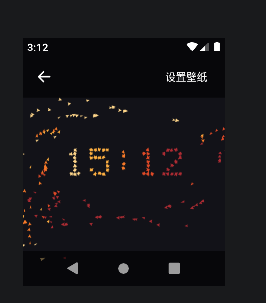

# CbirdsWatch

Android 9（API 28）动态壁纸。在设备时间更新时，cbirds 的鸟群会重新排列成 HH:mm。WallpaperService 仅在壁纸可见时安排绘制。

在 Android Studio 中打开项目并选择 JDK 17 作为 Gradle JDK。命令行使用 JDK 17 运行 `./gradlew assembleDebug`。项目使用 SDK 35、NDK 30.0.16248370 和 CMake 4.1.2。生成的 APK 位于 `app/build/outputs/apk/debug/app-debug.apk`，包含 ARM 32 位、ARM 64 位和 x86 库。

首次构建需要在项目根目录的 `local.properties` 填写 `sdk.dir` 和本机的 `signing.storeFile`、`signing.storePassword`、`signing.keyAlias`、`signing.keyPassword`。密钥库的相对路径以 `app/` 为基准。

安装后打开「cbirds Clock」进入表盘设置。点「设为默认表盘」，然后在系统预览中确认。启用后，设置页可通过「更换壁纸」打开系统壁纸选择器。

表盘设置可调整鸟群数量（200–800 只，默认 420 只）和飞行速度（原版速度的 25%–100%，默认 50%）。调整会自动保存，表盘下一次绘制时读入。

原生渲染来源为 [clainstone/cbirds](https://github.com/clainstone/cbirds/tree/4cabce5bfed288aeb2924270851767c2978f7d35)。项目复制了该版本的 C 源码与 MIT LICENSE，并通过 `wallpaper_bridge.c` 接入其离屏渲染。

